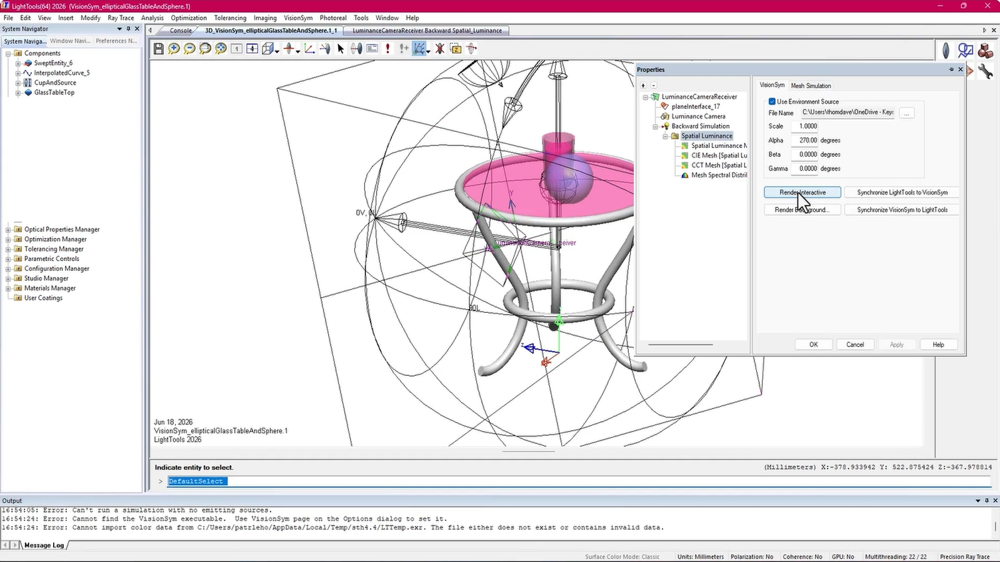
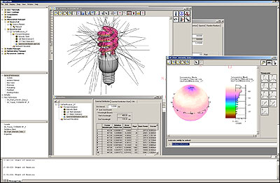

# LightTools Illumination Studies From Sources to Receivers

A lighting concept can deliver enough total flux while leaving an important region too dark.
LightTools supports three-dimensional illumination modelling, non-sequential ray tracing, and optimisation of systems where the distribution of light matters.
Follow the source, optical path, and receiver together when deciding whether a design meets its purpose.

## Describe the light that enters the system

Begin a LightTools simulation with a source definition that matches the available measurement or supplier data.
Position, emitting area, angular distribution, spectrum, and total output all influence the result.

### Separate source power from source direction

Increasing source output and narrowing its emission can both raise a peak receiver value.
They represent different design changes and should be tracked separately.

Record these inputs before comparing concepts:

- The source position and orientation in the assembly.
- The shape and extent of its emitting region.
- The angular distribution and any measured ray data.
- The wavelength range and spectral weighting.
- The radiometric or photometric quantity used to specify output.

The companion [section_emitters.rst](docs/src/plugin_reference/section_emitters.rst) discusses source representations.
[section_spectra.rst](docs/src/plugin_reference/section_spectra.rst) covers spectral parameters, and [variants.rst](docs/src/key_topics/variants.rst) explains alternative colour and numerical representations.

### Include polarization when it changes the question

Polarizing elements and some optical interfaces require attention to polarization state.
Decide whether that effect is relevant before treating all light as equivalent.

[polarization.rst](docs/src/key_topics/polarization.rst) provides a mathematical and implementation reference for a separate spectral rendering environment.
Use it to clarify the physical quantities being discussed in a comparison.

[](https://lighttools-simulation.github.io/lighttools-synopsys/)

## Put the measurement definition before the colour map

A receiver result depends on where light is collected and how that collection is divided into bins.
Define the receiver position, orientation, extent, and reported quantity before adjusting the visual presentation.

An illuminance map describes a different quantity from a luminous-intensity distribution.
Likewise, radiometric and photometric outputs use different weighting and units.

For an LED lens, a useful review might compare:

1. Collected flux within the intended target.
2. Variation across a defined working region.
3. Unwanted spill outside that region.
4. Sensitivity to source displacement.

The companion [section_sensors.rst](docs/src/plugin_reference/section_sensors.rst) describes measurement models.
[section_films.rst](docs/src/plugin_reference/section_films.rst) addresses output storage, while [section_rfilters.rst](docs/src/plugin_reference/section_rfilters.rst) discusses reconstruction.



### Calculate a metric from the numerical export

For a rectangular working region, one possible uniformity definition is minimum illuminance divided by mean illuminance.
Name the definition explicitly because another project may use a different ratio.

Prepare a headerless tab-delimited grid containing finite, nonnegative illuminance values for equal-area bins in the intended region.
This NumPy example calculates that specific ratio:

```python
import numpy as np

grid = np.loadtxt("receiver-grid.tsv", delimiter="\t")
if grid.ndim != 2 or not np.isfinite(grid).all() or (grid < 0).any():
    raise ValueError("Expected a finite, nonnegative 2D receiver grid.")
mean_value = float(grid.mean())
if mean_value <= 0:
    raise ValueError("Mean illuminance must be positive.")
print(f"Minimum/mean uniformity: {grid.min() / mean_value:.4f}")
```

Include intentionally dark bins when they belong to the required working area.
Keep the region and bin size identical across design comparisons.

## Inspect what happens between source and receiver

Non-sequential tracing allows a ray to encounter surfaces according to the three-dimensional geometry.
Reflections, refraction, scattering, and repeated encounters can all affect the final distribution.

### Geometry and surface response

Check imported geometry for the features that determine optical behaviour.
Small gaps, blocked apertures, or an incorrect interface can matter more than a visually detailed housing.

[scene_format.rst](docs/src/key_topics/scene_format.rst) illustrates explicit scene descriptions in the companion renderer.
[section_shapes.rst](docs/src/plugin_reference/section_shapes.rst) discusses geometry boundaries.

Define an optical property for each relevant surface.
Separate surface scattering, reflection, and transmission from the appearance used to identify objects in a design view.

For complementary reading, [section_bsdfs.rst](docs/src/plugin_reference/section_bsdfs.rst) covers surface scattering models.
[section_textures.rst](docs/src/plugin_reference/section_textures.rst) explains spatially varying parameters.

### Bulk scattering and absorption

A diffuser or light guide may require a volume model as well as surface properties.
Distinguish attenuation through a material from scattering at its boundary.

Three companion references separate those concepts:
[section_media.rst](docs/src/plugin_reference/section_media.rst) describes participating media;
[section_phase.rst](docs/src/plugin_reference/section_phase.rst) describes scattering direction;
[section_volumes.rst](docs/src/plugin_reference/section_volumes.rst) describes spatially varying volume data.

For a light guide, review extraction regions, coupling geometry, and losses together.
For a reflector, inspect both the intended path and secondary reflections that send light outside the target.



## Distinguish sampling noise from a design change

A brighter bin in one run does not automatically indicate a better optical design.
Monte Carlo estimates vary, particularly where relatively few paths contribute.

Increase the sampling effort and repeat the evaluation before trusting a small improvement.
Compare regional metrics alongside local peaks, and retain the numerical output used for the decision.

[section_samplers.rst](docs/src/plugin_reference/section_samplers.rst) explains sampling in the companion renderer.
[section_integrators.rst](docs/src/plugin_reference/section_integrators.rst) discusses alternative light-transport estimators.

### Run a separate reference scene consistently

An independent rendering experiment can help investigate a simplified optical assumption.
Use a complete Mitsuba XML scene with its own sources, geometry, materials, and sensor.

With Mitsuba installed and the scalar spectral variant available, this Python example renders that comparison scene to EXR:

```python
import mitsuba as mi

mi.set_variant("scalar_spectral")
scene = mi.load_file("reference-scene.xml")
image = mi.render(scene, seed=17, spp=512)
mi.util.write_bitmap("reference-result.exr", image)
```

Keep the seed fixed when checking repeatability within the same setup.
Changing the seed in additional runs helps reveal the size of random variation.

[rendering_tutorials.rst](docs/src/rendering_tutorials.rst) indexes complete rendering workflows.
A rendered image still needs a defined measurement and calibration before it can support a quantitative comparison with a LightTools receiver.

## Optimise a requirement that survives review

Choose design variables that correspond to changes the optical assembly can actually accommodate.
An objective such as uniformity should have an accompanying flux or efficiency requirement if brightness also matters.

Use a written comparison contract:

| Keep fixed during comparison | Record whenever it changes |
|---|---|
| Source output and spectral weighting | Source model revision or operating point |
| Receiver extent and measurement units | Target area or reporting quantity |
| Definition of uniformity or efficiency | Objective function and constraints |
| Geometry reference and coordinate convention | Optical dimensions or component placement |
| Sampling and result-processing procedure | Ray count, binning, filtering, or termination settings |

Avoid judging an optimisation only by the best-looking colour map.
Check whether improvement came from a better distribution, a different normalisation, or a changed measurement area.

[inverse_rendering_tutorials.rst](docs/src/inverse_rendering_tutorials.rst) introduces optimisation through differentiable rendering in Mitsuba.
It provides a complementary numerical perspective on parameter estimation.

For the LightTools study, validate the selected concept using the actual source and receiver definitions.
Then examine relevant variations, such as source position or optical component alignment, rather than relying only on the nominal result.

## Preserve the context of the calculation

Save the optical model, source data, material definitions, receiver settings, and exported numerical results together.
Record the software release and the analysis options required to reproduce the study.

For work involving imaging and illumination components, LightTools and CODE V interoperability can support a connected analysis workflow.
Check the supported exchange options for the installed releases before relying on a transferred model.

The companion [file_formats.rst](docs/src/key_topics/file_formats.rst) documents Mitsuba data containers.
[differences.rst](docs/src/key_topics/differences.rst) discusses version-related changes that can affect its scripts and plugins.

When consulting older LightTools Synopsys references alongside LightTools Keysight documentation, match the instructions to the installed release.
Keep a short record of model changes so that a later comparison can identify which inputs actually differ.

## Related Search Terms

lighttools simulation, lighttools synopsys, lighttools keysight, lighttools software, lighttools illumination design software, optics, raytracer, simulation, illumination, ray-tracing, spectral-rendering, optical-design, scientific-computing, python, optimization
